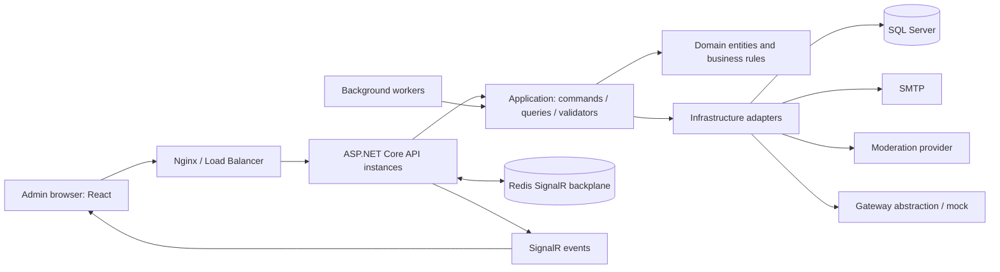

# PROJECT CONTEXT — eBay Clone Admin

## Context để viết Software Requirements và Software Design

> **Nguồn yêu cầu chính là `Requirement.txt`. Khi viết tài liệu, giả định hệ thống mục tiêu đáp ứng đầy đủ các yêu cầu của đề tài.** Codebase được dùng làm nền cho công nghệ, kiến trúc, tên module, dữ liệu và nghiệp vụ; không dùng các phần chưa hoàn thiện của code để thu hẹp yêu cầu đề bài.
>
> Đây là gói context độc lập, không phải báo cáo QA hay bằng chứng production deployment. Giả định đầy đủ chức năng không cho phép bịa số liệu tải, kết quả JMeter, SLA, lịch sử Jira hoặc chứng nhận bảo mật.

## 1. Cách dùng context và phân biệt nguồn thông tin

Ba ký hiệu được dùng xuyên suốt:

- **[R] Requirement:** yêu cầu trực tiếp của đề bài, bắt buộc có trong Software Requirements và được giải quyết trong Software Design.
- **[C] Code context:** thông tin có cơ sở từ source hiện tại: công nghệ, module, entity, trạng thái, service và luồng nghiệp vụ.
- **[D] Design assumption:** chi tiết/giả định thiết kế hợp lý để cụ thể hóa phần đề bài chưa chốt. Ghi rõ là giả định/tham số cần thống nhất, không coi là nguyên văn đề bài hoặc kết quả đã đo.

Thứ tự ưu tiên: **[R] → [C] → [D]**. Nếu code và yêu cầu chưa trùng hoàn toàn, mô tả hệ thống mục tiêu hoàn chỉnh theo [R], dùng [C] làm nền và nêu lựa chọn [D]. Không biến tài liệu thành danh sách “đã làm/chưa làm”; cũng không khẳng định mọi thiết kế mục tiêu đều đã có nguyên dạng trong source.

- **Software Requirements / SRS:** hệ thống phải làm gì; bối cảnh, stakeholders, phạm vi, actors, use cases, functional requirements, business rules, data requirements, external interfaces, non-functional requirements và acceptance criteria.
- **Software Design / SDD/SDS:** giải pháp thực hiện như thế nào; kiến trúc, component/module, dữ liệu, API, sequence/activity/state diagrams, bảo mật, concurrency, vận hành và deployment.
- Dùng mã requirement nhất quán để truy vết giữa hai tài liệu. Có thể dùng Mermaid, nhưng không tự coi một ô logical component là một microservice riêng.

## 2. Mô tả, vấn đề và phạm vi dự án

**Tên làm việc:** eBay Clone — Administration and Operations System / Hệ thống quản trị và vận hành sàn thương mại điện tử kiểu eBay.

Đây là đồ án nhóm sinh viên về backend và Admin panel cho sàn thương mại điện tử nhiều buyer/seller. Admin theo dõi hoạt động, quản lý tài khoản, kiểm duyệt nội dung, giám sát đơn hàng, giải quyết tranh chấp/hoàn trả và gửi cảnh báo/thông báo.

### 2.1. Vấn đề cần giải quyết

- Người vận hành cần góc nhìn tập trung về user, product, order và các việc chờ xử lý.
- Vi phạm tài khoản/sản phẩm/đánh giá cần được phát hiện, xử lý có căn cứ và lưu vết.
- Dispute/return cần bằng chứng, phân công, quyết định và cập nhật tài chính nhất quán.
- Cần doanh thu, đơn hàng và tăng trưởng user theo ngày/tháng/quý để hỗ trợ quyết định.
- Dữ liệu nhạy cảm và các quyền quản trị phải được bảo vệ, không lộ qua API/logs.
- Hệ thống phải chịu được lượng truy cập tăng, hạn chế lạm dụng và cập nhật không gián đoạn.

### 2.2. Mục tiêu

1. Quản trị tập trung, giao diện dễ sử dụng cho admin không chuyên kỹ thuật.
2. Phân vai rõ, quyền tối thiểu, truy vết đúng người thao tác.
3. Bao phủ đầy đủ chức năng Admin của đề bài và các yêu cầu vận hành bổ sung.
4. Bảo vệ dữ liệu nhạy cảm, tính nhất quán nghiệp vụ và khả năng mở rộng.
5. Có CI/CD, quản lý nhóm và kiểm thử tải/an ninh phù hợp đồ án.

### 2.3. Ranh giới phạm vi

- **Bắt buộc:** 14 yêu cầu Admin và 6 yêu cầu bổ sung ở mục3.
- **Mở rộng từ code:** categories; seller performance/levels; ví seller, platform fees, settlement/payout/withdrawal; realtime; report export; scheduled notifications; demo/mock data.
- **Không tự đưa vào phạm vi bắt buộc:** toàn bộ cart/checkout, đấu giá hoàn chỉnh, tích hợp shipping/payment thật, recommendation engine, chat marketplace tổng quát hoặc mobile app.
- Buyer/Seller là actors và bối cảnh cho nghiệp vụ Admin, không đồng nghĩa phải viết tài liệu cho toàn bộ eBay. Có entity Bid/Coupon/Inventory/Payment không tự chứng minh toàn bộ phân hệ tương ứng là yêu cầu đề tài.

## 3. Danh mục yêu cầu đề tài — nguồn chính

`Requirement.txt` có14 dòng yêu cầu Admin và6 dòng yêu cầu bổ sung. Mã R-A/R-N dưới đây phục vụ truy vết, không phải mã có sẵn trong file gốc.

### 3.1. Yêu cầu Admin

| Mã | Nội dung đề bài | Diễn giải hệ thống mục tiêu |
|---|---|---|
| R-A01 | Dashboard tổng quan: số user, sản phẩm, đơn hàng | Hiển thị số liệu đúng quyền, nhãn và khung thời gian rõ ràng. |
| R-A02 | Danh sách user: duyệt tài khoản mới, khóa/mở khóa | Tìm/lọc/xem profile, duyệt/từ chối, khóa/mở khóa có lý do và audit. |
| R-A03 | Danh sách sản phẩm: xóa hoặc ẩn sản phẩm vi phạm | Xem report/bằng chứng, quyết định xử lý; giữ được dấu vết và dữ liệu liên quan. |
| R-A04 | Quản lý đơn hàng toàn hệ thống | Tìm/lọc/xem chi tiết mọi đơn theo quyền, theo dõi trạng thái và case liên quan. Thao tác hủy/sửa đơn trực tiếp cần đặc tả riêng nếu nhóm chọn. |
| R-A05 | Thống kê ngày/tháng/quý: doanh thu, đơn hàng, user mới | Đủ cả ba chỉ số ở các kỳ; thống nhất timezone, công thức và phạm vi trạng thái đơn. |
| R-A06 | Giám sát Review + Feedback | Xem nội dung/uy tín seller, report và moderation; không bỏ phần Feedback. |
| R-A07 | Dispute: duyệt, điều phối, phân xử | Tiếp nhận/xem bằng chứng, phân công, phán quyết và cập nhật đối tượng liên quan có audit. |
| R-A08 | Xét duyệt hoàn trả đơn hàng | Duyệt/từ chối/theo dõi return và refund đúng quyết định, không chỉ xem danh sách. |
| R-A09 | Email cảnh báo hoặc thông báo toàn bộ user | Gửi đúng nội dung/đối tượng/kênh, theo dõi trạng thái và tránh gửi trùng. |
| R-A10 | Admin panel chỉ từ IP nội bộ hoặc xác minh2FA | Ngoài auth/quyền hợp lệ, thỏa IP nội bộ **hoặc** đã xác minh2FA; không đổi “hoặc” thành bắt buộc đồng thời cả hai. |
| R-A11 | Phân quyền từng loại admin: monitor, support… | Enforce ở backend và phản ánh ở UI; không chỉ ẩn menu. |
| R-A12 | Dashboard mở rộng nhiều thống kê hơn | Có cấu trúc thêm widget/metric/query; không bắt buộc drag-and-drop dashboard nếu đề bài không yêu cầu. |
| R-A13 | Log riêng dữ liệu nhạy cảm, mã hóa khi lưu | Tách sensitive audit, mã hóa payload, giới hạn decrypt và audit việc truy cập. |
| R-A14 | UI dễ dùng cho admin không chuyên kỹ thuật | Điều hướng rõ, tìm/lọc/phân trang, xác nhận thao tác nguy hiểm, loading/lỗi/thành công dễ hiểu. |

### 3.2. Yêu cầu bổ sung — nhóm25% số điểm

| Mã | Nội dung đề bài | Đặc tả/thiết kế cần có |
|---|---|---|
| R-N01 | Đáp ứng khi user tăng: load balance, Nginx | Nhiều API instances, cân bằng tải, capacity và realtime phù hợp scale. |
| R-N02 | Rate limiting theo người trong khoảng thời gian | Quota/window theo user/IP, bảo vệ login/OTP/API, phản hồi429 nhất quán. |
| R-N03 | CI&CD: Jenkins, GitHub Actions | Build/test/package/deploy có kiểm soát. Code chọn GitHub Actions; nếu giảng viên bắt buộc cả Jenkins thì bổ sung phương án, không tự hiểu là được miễn. |
| R-N04 | Quản lý team: Jira | Backlog, phân công, sprint/tiến độ, bugs và liên kết thay đổi. Không tự thay Jira bằng công cụ khác khi chưa được chấp thuận. |
| R-N05 | Kiểm thử tải/an ninh: JMeter | Test plans, workload, assertions, đo lường và phân tích; không bịa kết quả thực nghiệm. |
| R-N06 | Zero downtime khi cập nhật: K8s | Rolling update, readiness/draining, capacity và tương thích API/schema; kiểm chứng bằng traffic liên tục trong rollout. |

Đề bài không có trọng số riêng cho từng chức năng, số concurrent users, response-time SLA hay retention period. Nếu cần, ghi tham số/giả định [D], không tự tính phần trăm hoàn thành.

## 4. Stakeholders, actors và quyền

### 4.1. Stakeholders

Đơn vị vận hành sàn; đội admin; buyer/seller chịu tác động; nhóm phát triển/kiểm thử/vận hành; giảng viên/người đánh giá. Nhóm vận hành cần số liệu và kiểm soát rủi ro; người dùng cần xử lý minh bạch; nhóm kỹ thuật cần hệ thống duy trì được.

### 4.2. Actors

| Actor | Trách nhiệm |
|---|---|
| SuperAdmin | Role/admin accounts, cấu hình và quản trị có thẩm quyền, audit; privileged sensitive log decrypt. |
| Monitor | Theo dõi dashboard/report và dữ liệu được phép; không mutation nghiệp vụ ngoài quyền. |
| Support | Duyệt tài khoản, xử lý vi phạm/reviews/disputes/returns và thông báo theo phạm vi được giao. |
| Buyer | Nguồn order/review/dispute/return/evidence; nhận quyết định, không mặc nhiên truy cập Admin panel. |
| Seller | Nguồn product/reply/evidence; chịu tác động của moderation, case và tài chính; không mặc nhiên là admin. |
| System/Worker | Xử lý settlement/payout/escalation/auto-review… bằng identity hệ thống, không giả người thao tác. |
| External services | SMTP, Redis, AI moderation và payment gateway abstraction. |

[C] Có tên `Administrator` để tương thích source. [D] Trong tài liệu phải chốt đây là role chung/alias hay role riêng và liệt kê quyền, không cho nó tự vượt quyền SuperAdmin. Phân biệt role Buyer/Seller với vai trò admin chi tiết.

### 4.3. Ma trận quyền mục tiêu tham khảo [D]

Đề bài không chốt từng ô. Ma trận cần nhất quán trong SRS và SDD; không coi đây là nguyên văn đề bài hoặc xác nhận mọi endpoint hiện đang dùng đúng bảng này.

| Chức năng | Monitor | Support | SuperAdmin |
|---|---|---|---|
| Dashboard | Xem | Xem | Xem |
| Thống kê/report | Xem | Theo quyền được cấp | Xem/export |
| User/product/order | Xem phần cho phép, có mask | Xem/xử lý theo policy | Quản trị |
| Duyệt/khóa/moderation | Không | Trong phạm vi được cấp | Có |
| Dispute/Return | Chỉ đọc nếu được cấp | Điều phối/phán quyết theo policy | Điều phối/phán quyết |
| Broadcast | Không | Theo policy | Có |
| Role/admin accounts | Không | Không | Có |
| Audit logs | Theo policy riêng | Theo policy riêng | Có |
| Sensitive log decrypt | Không | Không | Có, có audit |

[C] Policies trong source: ViewDashboard, ViewReports, ManageUsers, ManageProducts, ManageOrders, ManageDisputes, ModerateReviews, ManageBroadcasts, ManageAdminRoles, ViewAuditLogs, CanPurge. SDD phải ràng buộc quyền ở API/handler/DTO; UI guard không thay backend.

## 5. Chức năng và use cases

### 5.1. Authentication, 2FA và phiên

- UC-01: Đăng nhập; xác minh credentials, trạng thái tài khoản, quyền và điều kiện IP/2FA trước cấp quyền truy cập panel.
- UC-02: Setup QR/TOTP, xác minh setup và OTP khi đăng nhập theo policy.
- UC-03: Xem identity hiện tại, đăng xuất, xử lý token/phiên hết hạn hoặc bị từ chối.
- [C] AuthEndpoints có login/logout/me, enable-2fa, verify-2fa-setup, verify-2fa; BCrypt/JWT/Otp.NET/QRCoder.
- [D] Dấu xác minh2FA phải thuộc identity/phiên được backend tin cậy, không chỉ frontend state. Xem điều kiện logic ở mục6.1.

### 5.2. Dashboard và thống kê

- UC-04: Xem tổng user/product/order, trạng thái đơn và action center các việc chờ xử lý.
- UC-05: Chọn ngày/tháng/quý/khoảng ngày; xem đủ revenue/orders/new users và xu hướng.
- UC-06: Drill-down sang danh sách liên quan; export Excel/PDF là mở rộng từ code.
- [C] DashboardPage, MetricTiles, RevenueChart, OrderDistribution, ActionCenter, useDashboardData, Dashboard/Stats queries.
- [D] Chốt công thức GMV/platform revenue/seller earnings; chỉ số và export dùng cùng filter/timezone.

### 5.3. Người dùng và seller

- UC-07: Tìm/lọc/phân trang user theo role/status/approval và thông tin được phép.
- UC-08: Xem profile, lịch sử xử lý, thông tin nhạy cảm đã mask.
- UC-09: Duyệt/từ chối tài khoản mới, khóa/mở khóa kèm lý do, điều kiện nghiệp vụ và audit.
- [C] Có approval và active/ban riêng, verification/CCCD lookup, violation counters, auto-review; seller metrics/level/criteria/wallet là phần hỗ trợ.
- [D] Khóa tài khoản còn order/giao dịch mở phải có policy, không làm mất nghĩa vụ và lịch sử.

### 5.4. Product/category và vi phạm

- UC-10: Xem/tìm/lọc sản phẩm toàn sàn, seller/category và trạng thái kiểm duyệt.
- UC-11: Xem reports/bằng chứng; quyết định Hide, loại khỏi hiển thị, Reject report hoặc Restore.
- UC-12: Cảnh báo seller, cập nhật violation/state, audit và notifications.
- [C] ProductModerationPage, ProductReport, ResolveProductViolation; action Hide/DeleteAndWarn/Reject/Restore.
- [C] Soft ban/hide cho moderation khác API seller hard-delete; không xóa vật lý lịch sử order/ledger chỉ vì sản phẩm vi phạm.

### 5.5. Order toàn hệ thống

- UC-13: Xem/tìm/lọc/phân trang đơn theo thời gian/status/buyer; mở chi tiết và case liên quan.
- Chi tiết có buyer, items/product/seller, tiền/phí/earnings, payment/shipping khi có, dispute/return.
- State có thể thay đổi bởi case/refund/settlement workflow, kèm lý do và audit.
- [D] Thao tác admin hủy/sửa đơn trực tiếp cần scope/conditions riêng, không suy ra CRUD order không giới hạn từ một dòng đề bài.

### 5.6. Review và Feedback

- UC-14: Theo dõi reviews/feedback, rating/comment, seller reply, reports và moderation status.
- UC-15: Quyết định giữ/ẩn, cập nhật violation/restriction theo policy và thông báo.
- [C] Review là đánh giá sản phẩm; Feedback giữ chỉ số uy tín tổng hợp seller (average rating/total reviews/positive rate); SellerReply thuộc Review.
- [D] Tài liệu phải bao phủ cả Review và Feedback. Làm rõ nếu giảng viên dùng “feedback” để chỉ một loại bình luận riêng.
- AI hỗ trợ moderation từ code; không thay thẩm quyền admin. Cần luồng lỗi/kết quả không chắc chắn khi AI không sẵn sàng.

### 5.7. Dispute

- UC-16: Xem queue, lọc status/type/priority/deadline; xem order và evidence.
- UC-17: Duyệt và điều phối/assign; lưu assignee/time và actor phân công.
- UC-18: Phán quyết Buyer/Seller/Split có lý do, refund amount/return nếu cần; cập nhật case/order/financials và thông báo.
- [C] Có case ID, raised by, evidence hai bên, negotiation/offer, assignee, resolver và refund/return tracking.
- [D] Actor từ phiên khác assignee trong body; cả quyền thực hiện và target phải hợp lệ.

### 5.8. Return/refund

- UC-19: Xem request/order/buyer/evidence, shop solution, messages và lịch sử.
- UC-20: Approve/reject/adjudicate/freeze; chọn giữ hàng/hoàn tiền hoặc yêu cầu trả hàng.
- UC-21: Theo dõi label/shipment/nhận hàng, hoàn tiền và kết thúc phù hợp quyết định. Đây là luồng mục tiêu hoàn chỉnh của R-A08.
- [C] Có approve/reject/adjudicate/freeze/return-label, ResolutionAction, AdminNote, ResolvedByAdminId, IsRefundedByEbayFund.
- [D] Chốt thời hạn, nguồn tiền, bước xác nhận nhận hàng và gateway state; ledger update không tự chứng minh đã hoàn tiền thật.

### 5.9. Email/InApp/broadcast

- UC-22: Soạn cảnh báo/thông báo, chọn audience/kênh, xác nhận gửi.
- UC-23: Xem history/trạng thái/người tạo, lỗi đã loại thông tin nhạy cảm và recipient read state.
- [C] Audience All/Buyer/Seller/Group, channels Email/InApp, Notification/UserNotificationRead, SMTP/SignalR.
- [C] ScheduledAt và Scheduled/Pending/Sent hỗ trợ phần hẹn giờ mở rộng, không tự biến hẹn giờ thành yêu cầu gốc.
- [D] Nếu chọn scheduled delivery vào scope, cần dispatcher, retry/idempotency và failure state; “đã lưu lịch” khác “đã gửi”.

### 5.10. Role và audit

- UC-24: SuperAdmin quản lý role/admin accounts và assignments.
- UC-25: Xem audit theo actor/action/target/time, có paging/filter.
- UC-26: SuperAdmin decrypt sensitive log sau authorization/integrity check, ghi audit việc đọc.
- [C] AdminAction là audit thông thường; SensitiveDataLog là payload nhạy cảm mã hóa riêng. Không sao chép plaintext sensitive payload vào general logs.

### 5.11. Financial support — phần mở rộng từ code

- Platform fees, order fee và seller earnings.
- SellerWallet pending/available/locked/disputed, ledger FinancialTransaction.
- Settlement giải phóng earnings đủ điều kiện; withdrawal khóa tiền rồi duyệt/từ chối; payout batch/config/history/exceptions/release hold.
- Seller performance/levels và criteria có thể hỗ trợ policy vận hành.
- Payment gateway có interface/mock; không tự coi tích hợp ngân hàng/VNPay/Stripe thật là bắt buộc để đáp ứng đề bài Admin.

## 6. Luồng nghiệp vụ để dựng sequence/activity diagrams

### 6.1. Đăng nhập/kiểm tra quyền

Credentials → backend xác minh tài khoản → điều kiện IP/2FA → cấp phiên/claims → mỗi request xác thực + authorization cho action/resource → DTO phù hợp quyền. Sai credentials/OTP/role bị từ chối và rate-limit lạm dụng.

**Logic mục tiêu [R+D]:** `Authenticated AND Authorized AND (InternalIP OR Verified2FA)`. IP nội bộ không miễn đăng nhập. IP ngoài vẫn phải có đường đăng nhập/xác minh2FA hợp lệ, không bị chặn trước khi có thể hoàn thành xác minh. SDD cần mô tả trusted proxies và cách lấy IP đúng.

### 6.2. Duyệt/khóa user

Admin có quyền → chọn user/xem profile mask → kiểm tra trạng thái/điều kiện → nhập quyết định/lý do → validate actor/target → cập nhật status/approval/violation → audit → notification → UI refresh. Actor sai hoặc state không hợp lệ bị chặn trước mutation.

### 6.3. Moderation

Report/phát hiện → moderation queue → admin xem evidence → quyết định → state/violation → audit + notification/realtime. Restore cần quyết định hợp lệ, không xóa dấu vết cũ.

### 6.4. Resolve dispute

Escalate/duyệt → assign → admin kiểm tra order/evidence/financial state → Buyer/Seller/Split + reason/refund → validate → cập nhật case/order/wallet/ledger nhất quán → audit/system message → thông báo/realtime.

[D] Chống xử lý cùng case hai lần, hai admin cùng resolve và financial mutation dở dang. External gateway timeout/fail cần trạng thái/đối soát, không thành công giả.

### 6.5. Return

Request/evidence → admin review → Reject, KeepItem/refund, RequireReturn hoặc Frozen → nếu cần trả hàng thì label/shipment/nhận hàng → kiểm tra refund → cập nhật order/financial/audit/notification → kết thúc.

[C] ReturnRequestEscalationService dùng pending quá3 ngày làm mốc tham khảo. Đây là tham số từ code, không phải SLA bắt buộc của đề bài.

### 6.6. Broadcast

Admin có quyền → nội dung/audience/channel → xác nhận → Notification + audit actor từ phiên → InApp/SMTP → delivery state/realtime → read state riêng theo recipient. [D] Gửi lớn/retry có thể cần batch/outbox/idempotency; không tự bắt buộc thêm message broker nếu chưa cần.

### 6.7. Sensitive audit

Nghiệp vụ → logger nhận payload tối thiểu → AES-GCM + integrity metadata → stage cùng unit-of-work → commit. Đọc: privileged request → auth/integrity/decrypt → audit đọc → tối thiểu hóa response/no-store → UI không log payload và clear state khi đóng/yêu cầu mới.

## 7. Business rules

| Mã | Quy tắc | Nguồn |
|---|---|---|
| BR-01 | Actor audit từ identity hợp lệ; CreatedBy/AdminId trong body không quyết định người thao tác. | [C+D] |
| BR-02 | Account approval và active/ban là hai khía cạnh; lưu quyết định/người/thời gian/lý do. | [C] |
| BR-03 | Moderation không làm mất order/history/ledger; soft hide/ban phù hợp mục đích giữ vết. | [C+D] |
| BR-04 | Case/refund state và financial/audit phải nhất quán. | [R+C+D] |
| BR-05 | Không refund/payout/withdraw trùng vì retry/double-click/nhiều replicas. | [D] |
| BR-06 | Refund amount/nguồn tiền đúng policy; code có nhánh cho LockedBalance âm khi refund. Nếu chọn policy đó phải giải thích nghĩa vụ tài chính, không giả định mọi balance luôn không âm. | [C+D] |
| BR-07 | Chuẩn hóa/HMAC lookup CCCD nhất quán; không so trùng bằng ciphertext ngẫu nhiên. | [C] |
| BR-08 | Chỉ decrypt tại boundary được phép, không xuất sensitive values đại trà qua DTO/log. | [R+C] |
| BR-09 | Dashboard/chart/export thống nhất kỳ, timezone, công thức và trạng thái đơn. | [R+D] |
| BR-10 | Delivery/read state theo đúng audience/recipient, không cờ đọc toàn cục cho mọi người. | [C+D] |
| BR-11 | Transition hợp lệ, terminal state không bị xử lý lại tùy tiện. | [D] |
| BR-12 | Startup không tự seed/sửa dữ liệu cũ; workers được bật có chủ đích. | [C] |

Phí, tiền tệ, cách làm tròn, timezone, hạn mức/thời hạn refund/dispute/return, retention và seller criteria chưa được đề bài chốt. Ghi configuration/assumption; không lấy số từ seeder làm policy chính thức.

## 8. Vocabulary trạng thái

### 8.1. Dispute [C]

- Status: Open, AwaitingSellerResponse, Negotiating, Escalated, AssignedToAdmin, UnderReview, Resolved, Closed.
- Type: INR (không nhận hàng), INAD (khác mô tả), Damaged, Counterfeit, Other.
- Priority: Critical/High/Medium/Low; winner: Buyer/Seller/Split.

[D] Không mặc định mọi case đi qua tất cả state theo một đường thẳng. State diagram phải có guards, nhánh và terminal conditions.

### 8.2. Return [C]

Pending, Approved, AwaitingShipment, InTransit, Delivered, Completed, Rejected, Escalated, WaitingForReturnLabel, ReturnLabelProvided, Frozen.

[D] Nhánh không cần trả hàng khác nhánh trả hàng; “approved” không tự nghĩa là tiền đã refund thành công. Bổ sung gateway/refund state nếu chọn tích hợp đó.

### 8.3. Đối tượng khác

User có Status và ApprovalStatus riêng; Product có Status; Review có Status/ModerationAction; Notification có Status/ScheduledAt/SentAt; PayoutTransaction/WithdrawalRequest có lifecycle riêng. Không dùng chung một enum đơn giản cho mọi nghiệp vụ hoặc coi mọi string status đều tương đương.

## 9. Data context

### 9.1. Entity theo nhóm [C]

| Nhóm | Entity |
|---|---|
| Identity/admin | User, ApplicationUser/ASP.NET Identity tables, AdminRole, AdminUserRole, AdminAction. |
| Catalog/marketplace | Product, Category, Store, Inventory, ProductReport, Bid, Coupon. |
| Order | OrderTable, OrderItem, Address, Payment, ShippingInfo. |
| Reputation | Review, ReviewReport, Feedback. |
| Case handling | Dispute, DisputeMessage, ReturnRequest. |
| Financial | SellerWallet, FinancialTransaction, PlatformFee, PayoutConfig, PayoutTransaction, WithdrawalRequest, SellerLevelCriteria. |
| Communication | Notification, UserNotificationRead, Message. |
| Sensitive audit | SensitiveDataLog. |

### 9.2. Data dictionary tổng quan

| Entity | Thuộc tính/ý nghĩa chính |
|---|---|
| User | Id, username/email, password hash, role/status/approval, approval/ban actor/time/reason,2FA settings, verification/violation/seller metrics, CCCD/CccdLookupHash/VerificationDocuments/BankAccountMock. |
| Product | SellerId/CategoryId, title/description/price/images, status, report/moderation/verification metadata. |
| OrderTable | BuyerId/AddressId, order time/status/total, completion/dispute/settlement dates, PlatformFee/SellerEarnings. |
| OrderItem | OrderId/ProductId, quantity/unit price. |
| Review/ReviewReport | Product/reviewer, rating/comment/reply, reports/flags/moderator/action/time. |
| Feedback | SellerId, AverageRating, TotalReviews, PositiveRate. |
| Dispute | CaseId/order/raised by, type/priority/state, evidence, negotiation, assignment/resolver/time, winner/refund/return metadata. |
| DisputeMessage | Case/sender/type/content/evidence/system update/timestamps. |
| ReturnRequest | OrderId/UserId, reason/evidence/status, admin note/resolution, label, refund-fund flag. |
| SellerWallet | SellerId, Pending/Available/Locked/Disputed, totals earned/withdrawn/refunded, update time. |
| FinancialTransaction | Seller/order references khi có, type/amount/time để đối soát. |
| PayoutTransaction | SellerId/amount/status, BankSnapshot, SessionId, sanitized error, create/complete time. |
| WithdrawalRequest | SellerId/amount, bank fields, status, processor/time/rejection/transaction reference. |
| Notification/UserNotificationRead | Title/content, user/role audience, type/status/schedule/sent/creator; read state theo user. |
| AdminRole/AdminUserRole | RoleName/Permissions/Description và role assignments. |
| AdminAction | AdminId/action/target type+ID, details phù hợp quyền, IP/time. |
| SensitiveDataLog | Actor snapshot/action/target/classification, encrypted payload, algorithm/key identifier/DataHash và audit metadata. |

Id/audit fields có thể được kế thừa, không chỉ nhìn một entity file để suy ra toàn bộ bảng. Ví dụ phải là dữ liệu giả, không đưa CCCD/bank/account/credentials thật.

### 9.3. Quan hệ để dựng ERD

- User(Buyer)1–N OrderTable; OrderTable1–N OrderItem; Product1–N OrderItem.
- User(Seller)1–N Product; Category1–N Product; seller liên quan Store/Wallet/Feedback.
- Product1–N Review/ProductReport; Review1–N ReviewReport.
- Order liên quan Dispute/ReturnRequest; Dispute1–N DisputeMessage.
- Seller liên quan financial/payout/withdrawal transactions; wallet phản ánh các trạng thái tiền.
- User M–N AdminRole qua AdminUserRole; Notification M–N người đọc qua UserNotificationRead.
- Audit có polymorphic TargetType/TargetId; không tự vẽ FK vật lý tới mọi bảng. Actor snapshot có thể cần giữ độc lập với account hiện tại.
- [D] Chốt nullable FK, unique1–1, delete rules và indexes theo mô hình được chọn; quan hệ logic không đồng nghĩa luôn có FK vật lý đã khai báo.

## 10. Kiến trúc và công nghệ

### 10.1. Stack có căn cứ từ source [C]

- Backend .NET10/ASP.NET Core, C#, Minimal API endpoint groups; React SPA trong Web project.
- Clean Architecture: Domain độc lập; Application phụ thuộc Domain; Infrastructure triển khai interfaces của Application; Web là presentation/composition root.
- CQRS/MediatR, DTOs, FluentValidation; authorization/validation/logging/exception pipeline behaviors.
- EF Core10/SQL Server/migrations; IApplicationDbContext và DbContext là abstraction dữ liệu. Không tự khẳng định có generic repository riêng cho mọi entity.
- React18, React Router6, Bootstrap/Reactstrap, Axios/fetch, SignalR client, Chart.js/Recharts; thư viện export Excel/PDF.
- BCrypt, JWT, ASP.NET Core Identity, Otp.NET/QRCoder; AES-GCM/HMAC cho data protection.
- SMTP, IContentModerationService/AI adapter; gateway abstraction/mock.
- Docker/Compose, Nginx, Kubernetes, Redis SignalR backplane, GitHub Actions.
- NUnit, Moq, Shouldly, SQL Testcontainers, React/Jest; JMeter test plans.

Không dùng mô tả .NET8/preview hoặc xUnit trong README cũ thay cho project configuration hiện tại.

### 10.2. Component diagram tổng quan

Luồng request: UI → API/middleware xác thực/quyền/rate-limit → MediatR pipeline → handler → context/services → EF/SQL → DTO phù hợp quyền → UI. Sơ đồ là logical components, không bắt buộc mỗi ô thành microservice/process riêng.

### 10.3. Identity

[C] Source có domain User cho nhiều SPA/JWT flows và ApplicationUser/ASP.NET Identity tables. [D] SDD phải xác định nguồn credentials, mapping identifier, role claims và token issuance/validation; không giả định ID hai bảng là cùng một miền hoặc mô tả hai identity logic mâu thuẫn.

### 10.4. API/interface conventions

- HTTP JSON; GET đọc, POST/PUT/DELETE cho mutation đúng nghĩa, server validate/authorize.
- Pagination/filter/sort cho lists; [D] thống nhất400/401/403/404/409/429/5xx và error contract không chứa stack/secret/PII.
- List DTO tối thiểu hóa/mask; privileged decrypt response no-store.
- SignalR đẩy dispute/return/notification/wallet events khi có; Redis hỗ trợ cross-instance.
- SMTP/AI/gateway qua adapters, có timeout/failure handling; không hardcode credentials vào diagram/design.

### 10.5. Module/endpoint tham khảo [C]

| Module | Chức năng API tiêu biểu |
|---|---|
| AuthEndpoints | login, verify-2fa, logout, me, enable-2fa, verify-2fa-setup. |
| Dashboard/Stats | metrics/dashboard; reports revenue/users/orders. |
| Users/AdminRoles | User list/detail/status/ban/unban/approve/reject; seller metrics/criteria; role/admin user/assignment. |
| Products/Categories/Reviews | Catalog queries, reports/moderation/resolution, reviews/replies. |
| Orders | List/detail. |
| Disputes | Statistics/list/detail/assign/resolve. |
| AdminReturnRequests | Detail/messages/approve/adjudicate/return-label/reject/freeze. |
| Broadcasts | Send/schedule/history/read state. |
| AuditLogs | Paged/filter, theo admin hoặc target. |
| SensitiveLogs | List/summary; POST decrypt theo log ID. |
| Financials/Wallets | Fees/settlement/payout config/run/history/exceptions/release hold/reports/wallet. |
| SystemAdmin/Mocking | Active IP monitoring, demo data; mock endpoints không phải business requirement production. |

Đây là tên module/route tương đối, không phải OpenAPI specification đầy đủ. Không tự suy mọi URL là `/api/{tên-class}`: source có GroupName/explicit mappings. SDD cần đặc tả exact contracts được chọn.

### 10.6. Module frontend

LoginPage/Enable2fapage; DashboardPage và components/dashboard; UsersPage/UserDetailPage; SellersPage; ProductModerationPage; OrdersPage; ReviewMonitoringPage; DisputesPage/DisputeDetailPage; ReturnRequestsPage/ReturnRequestDetailPage; BroadcastPage; AdminRolesPage/AuditLogsPage/SensitiveLogsPage; PayoutEnginePage/SellerPendingFundsPage. Các hooks/services gọi API, quản lý dashboard và SignalR; không đưa business security quyết định hoàn toàn sang client.

## 11. Bảo mật và W7-01

### 11.1. Các lớp bảo vệ mục tiêu

1. HTTPS, trusted proxy headers, giới hạn/validate đầu vào.
2. Credentials/password hash, JWT/phiên,2FA/IP access theo đúng R-A10.
3. RBAC/action/resource policy backend và UI guard tương ứng.
4. Authenticated actor cho audit; request không được tự gán người thao tác.
5. Rate limiting login/OTP/API theo user/IP, không dùng quota chung để một user chặn tất cả người khác [R+D].
6. Encryption và key lifecycle ngoài source, masking/minimization, privileged decrypt.
7. Sanitized logs/errors và negative-security tests.

### 11.2. W7-01 data protection [C]

- AesEncryptionService yêu cầu persistent Base64 key32 bytes; gcm:v1: envelope, nonce/tag và authenticated decrypt.
- PII/bank scope: User.CCCD/VerificationDocuments/BankAccountMock; PayoutTransaction.BankSnapshot; WithdrawalRequest.BankName/BankAccountName/BankAccountNumber.
- CccdLookupHash là HMAC lookup đã chuẩn hóa; index không unique là lựa chọn schema hiện tại, không suy ra unique chỉ vì có phát hiện trùng.
- SensitiveDataLog chứa encrypted payload + algorithm/key identifier/DataHash + actor/action/target metadata.
- SensitiveDataLogger stage log, không tự commit ngoài unit-of-work caller.
- SuperAdmin decrypt có integrity check và audit; lists không lộ plaintext/ciphertext không cần thiết.
- [D] JWT/SMTP/AI/TOTP secrets cần protection policy riêng; không nói tất cả secret đã được W7-01 mã hóa chỉ vì có encryption service.

### 11.3. Audit và key management

- General audit: actor/action/target/time/outcome, chỉ metadata đúng quyền.
- Sensitive audit: payload PII/financial/permission-sensitive được mã hóa và có access/retention riêng.
- Không log raw request body, token/key, bank JSON hoặc plaintext decrypt ra console/general logs.
- [D] Retention/purge/anonymization và export rights phải chốt; đề bài không có số ngày lưu.
- Key bền vững theo dataset; DB độc lập chưa có GCM có thể có key riêng; restore GCM cần đúng key. Không “tạo key mới khi decrypt fail”, không coi User Secrets là vault mã hóa.
- Frontend không nhận EncryptionKey, SQL credentials hoặc JWT signing secret; access token của phiên khác signing secret.

### 11.4. Schema/data conversion và startup safety [C]

- EF ProtectSensitiveData tạo/adopt SensitiveDataLogs, thêm CccdLookupHash/index và nới bank columns.
- CLI dry-run kiểm tra dữ liệu trước explicit apply; conversion không phải thao tác lặp ở mỗi API startup. Sau conversion, writers mới lưu GCM đúng từ đầu.
- Mặc định DatabaseInitialization:RunMigrationsOnStartup=false, Seeding:Mode=None, BackgroundJobs:Enabled=false.
- System chỉ thêm roles thiếu, giữ quyền/mô tả cũ; Demo chỉ Development + dataset mới/rỗng, transaction và không seed lặp.
- DisputesSeeder không delete/regenerate dữ liệu cũ, không patch wallets.

Flags local an toàn không nghĩa hệ thống mục tiêu thiếu background processing: môi trường vận hành chủ động bật/deploy worker. Các API/request-triggered tasks vẫn thực hiện nghiệp vụ theo quyền khi được gọi.

## 12. Background processing và consistency [C+D]

[C] Có5 hosted writer jobs: AutoReviewUsersService, ReturnRequestEscalationService, SellerEvaluationBackgroundService, SettlementBackgroundService, PayoutEngineBackgroundService.

[D] SDD cần thiết kế:

- Lịch chạy, điều kiện chọn bản ghi, owner và state/idempotency cho mỗi công việc.
- Nhiều replicas không được cùng payout/refund/settle một đối tượng thành nhiều lần ghi độc lập.
- Worker deployment riêng, lock/lease hoặc phân việc phù hợp; không mặc định cần broker phức tạp nếu đồ án không cần.
- Transaction boundary cho financial state/ledger/audit; concurrency control cho quyết định và số dư.
- SMTP/payment side effects không nằm trong SQL transaction đơn giản; cần state/retry/outbox/đối soát phù hợp nếu chọn.
- Shutdown/cancel/timeout không tạo trạng thái thành công giả hoặc tự retry lần ghi không rõ commit.

## 13. Thống nhất semantics của dữ liệu/reporting [D]

- Timezone nghiệp vụ, cách lưu/quy đổi timestamps, lịch ngày/tháng/quý.
- Khoảng thời gian dạng start-inclusive/end-exclusive để tránh bỏ mất cuối ngày.
- GMV khác platform revenue khác seller earnings; xác định cách xử lý refund/cancellation/phí hoàn trả.
- User mới theo thời điểm tạo hay duyệt; đơn mới hay đơn hoàn thành trong kỳ.
- Chart/metrics/export cùng filter/nguồn, không đếm trùng order khi join items.
- Tiền tệ và rounding/precision theo model/policy đã chọn; không lấy số demo/seeder làm chính sách chính thức.
- Mở rộng dashboard bằng component/query/DTO có quyền đọc và aggregation test tương ứng.

## 14. Non-functional requirements và đo lường

| Nhóm | Mục tiêu | Xác minh |
|---|---|---|
| Security | Đúng IP/2FA/auth/role; không lộ secrets/PII; encryption/integrity/audit đúng. | Negative-auth, spoofed actor, IP/OTP, fixture encryption/decrypt/tamper/wrong-key tests. |
| Performance/scale | Chịu workload tăng, paging/query/index/capacity phù hợp. | JMeter concurrency/ramp-up, percentiles, throughput/error rate và resources. |
| Rate limiting | Đúng quota/window/user/IP isolation. | Vượt quota,429/Retry-After, phục hồi sau window, user khác không bị ảnh hưởng. |
| Availability | Cập nhật không gián đoạn traffic trong phạm vi rollout đã xác định. | Requests liên tục trước/trong/sau deployment, latency/errors/readiness/in-flight requests. |
| Data integrity | Không mất/trùng financial mutation, state và relationships đúng. | Transaction/concurrency/retry, counts/FK/ledger reconciliation. |
| Usability | Admin không chuyên hoàn thành nhiệm vụ quan trọng. | Task completion/error observations, navigation/form/accessibility review. |
| Maintainability | Module/layer/contracts/tests rõ, thêm metric không viết lại dashboard. | Dependency review, test coverage theo rủi ro, extension scenario. |
| Operability/recovery | Health checks, sanitized logs, backup/config/key recovery. | Probe, recovery exercise phù hợp môi trường, kiểm tra khả năng decrypt sau restore. |

Không có ngưỡng cụ thể trong đề bài. Nếu cần số, dùng `N_concurrent_users`, `P95_latency_ms`, `Max_error_rate`, `Availability_target` hoặc nêu rõ là giá trị đề xuất [D] cần chốt. Không viết “đã chịu được X users/đã đạt SLA Y” nếu chưa có số liệu.

## 15. Deployment, CI/CD, Jira và JMeter

### 15.1. Mô hình triển khai

- Local đồ án: mỗi backend developer SQL/database riêng; frontend cấu hình API/proxy. Không chia sẻ key giữa DB độc lập nếu không chia sẻ ciphertext.
- Mục tiêu scale: Nginx/load balancer → nhiều API pods → SQL Server; Redis backplane; worker không xử lý trùng.
- [C] K8s tham chiếu2 API replicas, RollingUpdate maxUnavailable=0/maxSurge=1, readiness/liveness và graceful shutdown. Cấu hình không tự chứng minh availability thực nghiệm.
- Secrets truyền qua secret store/runtime injection, không chứa giá trị thật trong source/image/ConfigMap công khai.
- [D] SQL/Redis cần availability/recovery phù hợp nếu SLA bao gồm lỗi các thành phần đó; rolling API không tự tạo database HA.

### 15.2. Zero downtime và database compatibility

[R] Giữ yêu cầu zero downtime khi cập nhật. [D] Thiết kế phải có readiness, capacity dự phòng, request draining, backward-compatible API/schema, migration tách khỏi startup từng replica và rollback tương thích dữ liệu.

Thay đổi format mã hóa/schema không tương thích cần thiết kế chuyển tiếp expand/contract, version compatibility và writers phù hợp. Maintenance cutover local của W7-01 không phải bằng chứng mọi deployment đều zero downtime; cũng không tự cho phép loại R-N06 khỏi SRS. Thiết kế mục tiêu phải giải thích cách đáp ứng, không đánh đồng rolling config với kết quả đã đo.

### 15.3. CI/CD

[C] Repository có GitHub Actions CI/CD và Docker/K8s config. [D] Pipeline mục tiêu:

PR/push → restore/build → unit/domain/functional/UI checks cần thiết → security/config checks → build/version image → release/deploy K8s có kiểm soát → rollout verification → rollback nếu tiêu chí không đạt.

Không đưa secret vào logs/artifacts; không migrate/seed trên mọi pod. Nếu giảng viên bắt cả Jenkins, mô tả pipeline tương ứng/vai trò phối hợp, không bịa Jenkins đã được chạy. SDD nêu rõ trigger, quality gates, version/image, secrets và quyền deployment.

### 15.4. Jira

[R] Quản lý team bằng Jira. [D] Epic theo phân hệ → Stories/Tasks gắn requirement ID → subtasks/tests → Bugs; có assignee, priority, acceptance criteria, sprint/status và liên kết branch/PR. Không tự bịa thành viên, ticket IDs, board URL, sprint velocity hoặc ảnh minh chứng.

### 15.5. JMeter

[C] Có plans cho login smoke/brute-force, dashboard, user/order paging, dispute detail, IP whitelist,2FA và RBAC.

[R+D] Chuẩn bị dữ liệu/tài khoản giả → định nghĩa workload/ramp-up/duration → login/session/OTP flow đúng → baseline/tăng tải → business/security assertions → đo latency/throughput/errors/resources → phân tích bottleneck và rerun.

Tách positive business tests và negative-security tests. Không dùng password/PII thật trong tài liệu/test data; chỉ chạy tải/an ninh trên môi trường được phép. SRS cần tiêu chí chấp nhận, không có nghĩa được tự tạo số liệu benchmark.

## 16. Acceptance scenarios gợi ý

1. Monitor login đúng điều kiện, xem dashboard/report nhưng không duyệt user hoặc decrypt sensitive log.
2. Support duyệt pending user; lưu đúng actor/time/notification; request giả CreatedBy không đổi actor thật.
3. Admin xử lý product vi phạm; trạng thái hiển thị đúng, report/order/history còn truy vết.
4. Chọn ngày/tháng/quý; revenue/orders/new users và export thống nhất period/công thức.
5. Review và Feedback được xem/report/xử lý đúng policy, reply/aggregate phù hợp mô hình.
6. Dispute assign/resolve Buyer/Seller/Split cập nhật đúng case/order/funds/audit; resolve trùng không refund lần nữa.
7. Return đi đến reject, giữ hàng/refund hoặc trả hàng rồi refund theo quyết định; nguồn tiền và state được đối soát.
8. Broadcast đúng audience/channel; delivery/read state riêng, không gửi trùng vì retry.
9. IP ngoài cần2FA; IP nội bộ vẫn phải auth/quyền; gọi API trực tiếp không bypass.
10. Vượt quota nhận429, user khác vẫn có quota; login/OTP chống brute-force.
11. DB/general logs không lộ sensitive plaintext; privileged decrypt có audit; tamper/wrong-key bị từ chối.
12. Thêm dashboard metric bằng component/query bổ sung không phá dashboard cũ.
13. JMeter chạy đúng workload/security scenarios và đạt ngưỡng nhóm/giảng viên đã thống nhất, có số liệu thực khi nghiệm thu.
14. Traffic tiếp tục trong K8s rollout, in-flight requests/realtime/state được xử lý theo thiết kế multi-instance.
15. Restart API trên DB cũ không tự seed/sửa disputes/wallets; Demo chỉ ghi khi opt-in trên dataset đủ điều kiện.

Đây là input để viết acceptance criteria, không phải tuyên bố các scenario vừa được thực thi trong lượt tổng hợp context.

## 17. Traceability: yêu cầu → thiết kế → kiểm thử

| Requirement | Module/thiết kế | Kiểm thử/đánh giá |
|---|---|---|
| R-A01, R-A05, R-A12 | Dashboard/Stats/widgets/metric definitions | Aggregation/date boundaries/UI/chart/export/extension. |
| R-A02 | Users/approval/status/audit | Approve/reject/ban/unban, invalid actor/state. |
| R-A03 | ProductReport/moderation | Hide/ban/restore, rights/history. |
| R-A04 | Orders/list/detail/case links | Search/filter/paging/access/state consistency. |
| R-A06 | Review/ReviewReport/Feedback | Moderation/reply/aggregate/report handling. |
| R-A07 | Disputes/messages/assignment/financials | Buyer/Seller/Split/concurrency/funds/audit. |
| R-A08 | Return workflow/financial adapters | Approve/reject/RequireReturn/freeze/complete/refund. |
| R-A09 | Notification/SMTP/SignalR | Audience/channel/status/read/idempotency. |
| R-A10, R-A11 | Auth/TOTP/IP/RBAC | Internal/external IP,2FA,401/403,direct API access. |
| R-A13 | Encryption/logger/DTO/key lifecycle | Round-trip/wrong-key/tamper/masking/actor/decrypt audit. |
| R-A14 | React navigation/forms/feedback | Usability/accessibility/task completion. |
| R-N01 | Nginx/API instances/Redis | Load/scale/resources/cross-instance realtime. |
| R-N02 | User/IP partitioned rate limiting | Window/quota/isolation/429. |
| R-N03 | Pipeline/images/deployment gates | Build/test/release/rollback checks. |
| R-N04 | Jira backlog/sprint/traceability | Work items/acceptance linkage/team evidence. |
| R-N05 | JMeter plans/data/assertions | Load/security execution và phân tích. |
| R-N06 | K8s/readiness/draining/schema compatibility | Continuous rollout traffic, state preservation/rollback. |

## 18. Những quyết định cần công bố trong hai tài liệu

- Admin là scope chính; Buyer/Seller là context, không tự thêm toàn bộ marketplace.
- Chốt role Administrator, ma trận quyền và nguồn identity/identifier mapping.
- Chốt currency/rounding/timezone, công thức doanh thu và bộ trạng thái cho reporting.
- Chốt refund/return/dispute deadlines, nguồn tiền/giới hạn, concurrent-processing và idempotency policy.
- Chốt retention/export audit, secret/TOTP protection, token/session lifecycle.
- Chốt KPI/SLA/workload và phạm vi zero downtime; không thay thành số liệu “đã đạt” khi thiếu minh chứng.
- Tách yêu cầu bắt buộc và extensions: seller finance/levels, AI, scheduling, report export, mock/demo.
- Giữ nhất quán giữa requirements, use cases, ERD, contracts, state/sequence diagrams và acceptance tests.
- Không biến báo cáo gap lịch sử thành nguồn yêu cầu; không mang trạng thái DB/máy cá nhân hoặc mật khẩu demo vào hai tài liệu.

## 19. Bản đồ source nội bộ

File context này tự chứa thông tin; người nhận không bắt buộc có repository. Nếu có source thì đối chiếu:

- `Requirement.txt`: nguồn toàn bộ20 yêu cầu đề tài.
- `Directory.Build.props`, `Directory.Packages.props`, `src/Web/ClientApp/package.json`: stack/libraries.
- `src/Domain/Entities`, `src/Domain/Constants`: data/vocabulary.
- `src/Application`: commands/queries/DTOs/validators/interfaces/pipeline.
- `src/Infrastructure`: EF/migrations/identity/adapters/crypto/logger/workers/initialiser/seeders.
- `src/Web/Endpoints`, `Infrastructure`, `Services`, `Hubs`: API/middleware/realtime.
- `src/Web/ClientApp/src`: pages/components/hooks/services.
- `.github/workflows`, Docker/Compose, `k8s`: deployment/pipeline.
- `tests/`, `tests/jmeter/plans`: test levels/plans.

Không đọc database hoặc xuất secrets/PII để lập context. Không đưa mật khẩu, tên server riêng, personal identifiers hoặc production credentials từ các file local vào đây.

## 20. Prompt gửi cùng file cho ChatGPT

> Tôi cung cấp PROJECT CONTEXT cho đồ án eBay Clone Admin. Hãy viết Software Requirements và Software Design bằng tiếng Việt, rõ ràng, phù hợp đồ án nhóm sinh viên.
>
> Nguồn phạm vi bắt buộc là Requirement.txt, đã được tổng hợp thành14 yêu cầu R-A và6 yêu cầu R-N. Giả định hệ thống mục tiêu đáp ứng đầy đủ yêu cầu; không viết báo cáo thiếu sót triển khai. Dùng code context làm nền cho kiến trúc/module/entity/công nghệ. Phân biệt [R] yêu cầu gốc, [C] source tham chiếu, [D] giả định/đề xuất; không nói thiết kế mục tiêu chưa xác nhận là bằng chứng code hiện có.
>
> Trước hết lập outline hai tài liệu và bảng traceability, sau đó viết từng phần. SRS tập trung what: yêu cầu/use cases/business rules/data/NFR/acceptance. SDD tập trung how: architecture/components/data/interfaces/sequence/state/security/deployment và các quyết định thiết kế. Dùng requirement IDs thống nhất và Mermaid khi hữu ích.
>
> Giữ đúng Admin scope. Không bỏ Review + Feedback, IP nội bộ HOẶC2FA, Jira, JMeter, CI/CD, user/IP rate limiting, Nginx/load balancing và K8s zero downtime. Không tự thêm toàn bộ eBay marketplace. Chính sách/ngưỡng chưa được đề bài chốt phải ghi assumption/TBD; không bịa benchmark, SLA đã đạt hoặc minh chứng Jira/deployment. Không đưa secret/PII hoặc thông tin máy cá nhân vào tài liệu. Nếu chưa có template trường, dùng cấu trúc SRS/SDD thông dụng và ghi rõ đó là đề xuất.
